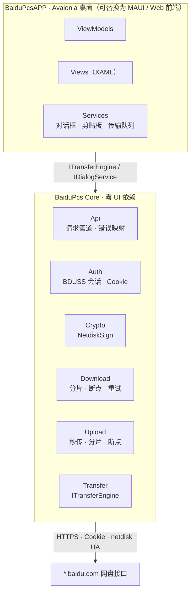

# BaiduPcs-CS · 百度网盘 C# 开源客户端

<p align="center">
  <a href="https://github.com/usre13243296/BaiduPcs-CS/releases/latest"></a>
  <a href="https://github.com/usre13243296/BaiduPcs-CS/releases"></a>
  <a href="https://github.com/usre13243296/BaiduPcs-CS/stargazers"></a>
  
  
  
  
  
</p>

**BaiduPcs-CS** 是一个用 **C# / .NET 10 + Avalonia** 从零重写的**百度网盘桌面客户端**：参考 MIT 开源的 [BaiduPCS-Go](https://github.com/qjfoidnh/BaiduPCS-Go) 的协议实现，把 BDUSS 登录、文件浏览、多线程分片下载、断点续传、秒传上传、传输队列做成可用的跨平台图形界面，发布包覆盖 **Windows / Linux / macOS，以及 NAS、软路由这类 ARM 设备**。

协议内核 `BaiduPcs.Core` 与 UI 完全解耦、零 Avalonia 依赖，同一份核心代码可以接 Avalonia 桌面、MAUI 移动端或 Web 管理界面——这是本项目与 `BaiduPCS-Go`（命令行）和官方客户端（闭源）最本质的区别。

<p align="center">
  
</p>

> **非官方项目声明**：BaiduPcs-CS 与百度公司无任何关联，不是官方客户端。项目仅用于学习与个人使用，请勿商用。使用第三方接口存在账号风控风险，请自行评估。

## 项目速览

| 项目 | 说明 |
|------|------|
| 名称 | BaiduPcs-CS（百度网盘 C# 客户端） |
| 定位 | 非官方、MIT 开源的百度网盘桌面客户端 |
| 语言 / 框架 | C# / .NET 10 + Avalonia 12.1（CommunityToolkit.Mvvm） |
| 支持平台 | Windows、Linux、macOS（x64 / arm64 单文件免安装） |
| 当前版本 | v0.6.0（下载 + 上传主链路可用） |
| 协议参考 | [BaiduPCS-Go](https://github.com/qjfoidnh/BaiduPCS-Go)（Go，MIT） |
| 代码规模 | 3 个项目、约 330 KB 源码、164 个单元/集成测试 |
| 许可证 | MIT |

## 目录

- [功能特性](#功能特性)
- [快速开始](#快速开始)
- [使用说明](#使用说明)
- [架构设计](#架构设计)
- [技术栈](#技术栈)
- [项目结构](#项目结构)
- [与同类工具对比](#与同类工具对比)
- [常见问题 FAQ](#常见问题-faq)
- [开发与测试](#开发与测试)
- [路线图](#路线图)
- [参与贡献](#参与贡献)
- [许可证](#许可证)
- [免责声明](#免责声明)
- [English Overview](#english-overview)
- [致谢](#致谢)

## 功能特性

### 登录与账号

- **BDUSS 登录**：粘贴浏览器里的 `BDUSS` 即可登录；高级模式可附加完整 Cookie 串，适配风控较严的账号。
- **Cookie 初始化与持久化**：先访问网盘首页收集服务器下发的 `BAIDUID` 等 Cookie，再调 `getinfo` 验证，避免裸 BDUSS 被风控拒绝；运行期吸收的 Cookie 会合并回账号并落盘。
- **多账号本地保存**：账号信息持久化到本地 `accounts.json`，重启自动恢复登录态，退出登录可切换账号。

### 文件管理

- 目录列表、面包屑导航、进入 / 返回上一级 / 刷新。
- 新建文件夹、重命名、删除、选中查看详情。
- 空间配额显示（已用 / 总量）。

### 下载

- **多线程分片**：统一 8 并发 + `WriteAt` 绝对偏移写入 `.part`，无合并步骤。
- **双下载通道**：「下载」以 locatedownload 签名直链为主通道（多备选链接逐个尝试），失败自动降级官方 `method=download` 通道；「复制链接」单独输出签名直链，可分享或用其他下载器接手。
- **断点续传**：`.part` 数据文件 + `.part.json` 断点元数据（记录每个分片剩余范围），中断 / 取消后对同一文件重新下载即可续传。
- **自动容错**：403/404/416 判死换直链；429/509 限流指数退避重连；断流 30 秒读超时重连；单分片连续失败升级为致命错误并展示原因。
- **进度与速度**：500ms 心跳刷新，周期采样速度模型，避免瞬时速度虚高。

### 上传

- **秒传与预创建二合一**：一次 `precreate` 请求同时拿到秒传结果与 `uploadid`；命中秒传时进度瞬间读满并标注「秒传命中」，与真实上传一眼区分。
- **分片并发上传**：按文件大小选择 4MB / 16MB / 64MB 分片档位，统一 4 并发，`locateupload` 动态获取上传服务器（失败降级 `pcs.baidu.com`）。
- **三份校验和单趟计算**：全文件 MD5、前 256KB MD5、逐块 MD5 一次读文件同时累计。
- **重名自动递增**：目标目录已有同名文件时自动改名为 `报告2.txt`、`报告3.txt`……不覆盖、不询问。
- **进程内断点续传**：复用 `uploadid` 跳过已传分片；会话过期（31363）自动重新预创建并整体重传。
- 单文件上传上限 128 GB。

### 传输任务管理

- 队列调度，同时传输 2 个任务；同远程路径 / 同本地文件自动去重。
- 暂停、恢复、取消、删除；失败任务可继续（重试）。
- 底部传输停靠栏实时展示进度、速度、状态与可读的中文错误详情。

### 界面与工程化

- **淡灰蓝浅色主题**：低光不刺眼，长时间使用舒适。
- **跨平台单文件发布**：6 个 RID 发布包，解压即用（Windows）。
- **164 个单元 / 集成测试**：密码学、协议层、下载引擎、上传引擎四层覆盖，不依赖任何 UI 框架。
- **全局异常兜底**：未处理异常写入本地日志，不静默崩溃。

## 快速开始

### 1. 下载发布包（推荐普通用户）

前往 [Releases](https://github.com/usre13243296/BaiduPcs-CS/releases/latest) 下载对应平台压缩包：

| 平台 | 架构 | 发布包 | 适用场景 |
|------|------|--------|----------|
| Windows | x64 | `BaiduPcs-v0.6.0-win-x64.zip` | 绝大多数 Windows 10/11 电脑 |
| Windows | arm64 | `BaiduPcs-v0.6.0-win-arm64.zip` | 骁龙 X 系列等 ARM Windows 设备 |
| Linux | x64 | `BaiduPcs-v0.6.0-linux-x64.zip` | 常规 x86_64 发行版 |
| Linux | arm64 | `BaiduPcs-v0.6.0-linux-arm64.zip` | NAS、软路由、树莓派等 ARM 设备 |
| macOS | Intel | `BaiduPcs-v0.6.0-osx-x64.zip` | Intel Mac |
| macOS | Apple Silicon | `BaiduPcs-v0.6.0-osx-arm64.zip` | M 系列芯片 Mac |

发布包为**自包含单文件**，无需预先安装 .NET 运行时。

**首次运行注意事项**

- **Windows**：解压后直接运行 `BaiduPcsAPP.exe`；未做代码签名，SmartScreen 可能提示「未知发布者」，选择「更多信息 → 仍要运行」。
- **macOS**：未签名应用首次运行需右键 →「打开」；若提示「已损坏」，执行 `xattr -cr BaiduPcsAPP`。
- **Linux**：需要系统具备 X11/Wayland 与 OpenGL 依赖（Avalonia 运行时要求，如 `libX11`、`libxcb`、`libGL`）；Windows 侧打包的 zip 不保留 Unix 执行位，解压后执行 `chmod +x BaiduPcsAPP`。

### 2. 获取 BDUSS

1. 浏览器登录 [pan.baidu.com](https://pan.baidu.com)。
2. 按 `F12` 打开开发者工具 →「应用 / Application」→「Cookie」。
3. 复制 `BDUSS` 的值（一串较长的字符），粘贴到登录窗口。

> BDUSS 等同于账号登录凭证，**请勿分享给他人**。它只保存在你本机的 `accounts.json` 中。

### 3. 从源码构建（开发者）

需要 [.NET 10 SDK](https://dotnet.microsoft.com/download)。

```bash
git clone https://github.com/usre13243296/BaiduPcs-CS.git
cd BaiduPcs-CS

# 构建
dotnet build BaiduPcsAPP/BaiduPcsAPP.csproj

# 运行
dotnet run --project BaiduPcsAPP/BaiduPcsAPP.csproj

# 跑测试
dotnet test BaiduPcs.Core.Tests/BaiduPcs.Core.Tests.csproj
```

## 使用说明

### 下载文件

1. 在文件列表中选中目标文件（文件夹暂不支持递归下载）。
2. 点击工具栏「下载」，任务进入底部传输面板排队。
3. 下载中可「暂停 / 继续 / 取消」；中断后对同一文件再次下载会自动读取 `.part.json` 续传。

**两个按钮的区别**

| 按钮 | 行为 | 适用场景 |
|------|------|----------|
| 下载 | locatedownload 签名直链为主，失败降级官方 `method=download`；走内置多线程引擎 | 常规下载，希望用满带宽 |
| 复制链接 | 只获取 locatedownload 签名直链并写入剪贴板 | 转存文件 403 兜底、分享给他人、交给 aria2/IDM 等下载器 |

### 上传文件

1. 进入目标目录，点击工具栏「上传」，选择一个或多个本地文件。
2. 若服务端已存在相同 MD5 文件，会命中**秒传**，瞬间完成并标注「秒传命中」。
3. 目标目录重名时自动递增为 `文件名2.扩展名`，不会覆盖已有文件。

> 当前版本支持多选文件上传，但**不支持整个目录递归上传**（在路线图中）。

### 传输管理

- 「传输」页与底部停靠栏展示所有任务，支持暂停、恢复、取消、删除、失败重试。
- 同时传输任务数为 2，其余任务排队等待；同一路径 / 同一本地文件不会重复入队。

### 数据存放位置

| 内容 | Windows | Linux | macOS |
|------|---------|-------|-------|
| 账号配置 `accounts.json` | `%APPDATA%\BaiduPcsApp` | `~/.config/BaiduPcsApp` | `~/Library/Application Support/BaiduPcsApp` |
| 异常日志 `app.log` | 同上 | 同上 | 同上 |
| 默认下载目录 | `%USERPROFILE%\Downloads\BaiduPcs` | `~/Downloads/BaiduPcs` | `~/Downloads/BaiduPcs` |

## 架构设计

核心思路是**把 Core 当成独立后端**：`BaiduPcs.Core` 从设计之初就是与 UI 完全解耦的「网盘协议内核」，具备三个特点：

1. **零 UI 依赖** —— 不引用 Avalonia、不依赖任何 UI NuGet 包；对话框、剪贴板、文件选择全部通过 APP 层的 `IDialogService` 抽象隔离。同一份核心代码可以接任意前端：Avalonia 桌面、MAUI 移动端、Web 管理界面（NAS / 软路由），扩展前端**无需改动任何协议与引擎代码**。
2. **协议与引擎完整** —— 登录（`Auth/`）、API 客户端（`Api/`）、下载引擎（`Download/`）、上传引擎（`Upload/`）全部位于 Core。下载引擎只接收 `Urls + CookieHeader`，与百度协议解耦，可复用为通用下载器。
3. **引擎可独立测试** —— 164 个用例不依赖任何 UI 框架：密码学算法对齐 Go 测试向量，协议层用 mock handler 验证参数，引擎层用本地测试服务器验证并发、断点、重试、暂停恢复。



## 技术栈

| 层 | 技术 |
|----|------|
| UI | Avalonia 12.1（跨平台 XAML） |
| MVVM | CommunityToolkit.Mvvm 8.4 |
| 运行时 | .NET 10 / C#（async/await，可空引用类型） |
| 签名 | System.Security.Cryptography（MD5 / SHA1） |
| 测试 | xUnit 2.9 + Microsoft.NET.Test.Sdk |
| 发布 | `dotnet publish` 自包含单文件（6 个 RID） |

## 项目结构

```
BaiduPcs.slnx
├─ BaiduPcs.Core/            # 核心库（无 UI 依赖，可独立接其他前端）
│  ├─ Api/                   # 百度网盘 API 客户端
│  │  ├─ BaiduPcsApiClient.cs        # 请求管道 / 错误映射
│  │  ├─ BaiduPcsApiClient.Auth.cs   # getinfo / bdstoken
│  │  ├─ BaiduPcsApiClient.FileSystem.cs # 列表 / mkdir / 删除 / 重命名
│  │  ├─ BaiduPcsApiClient.Download.cs   # locatedownload 直链
│  │  ├─ BaiduPcsApiClient.Upload.cs     # precreate / superfile2 / create / locateupload
│  │  ├─ PanHomeClient.cs    # 首页解析（sign1 / sign3 / timestamp）
│  │  └─ ErrorMessageCatalog.cs # 错误码 → 可读中文消息
│  ├─ Auth/                  # 登录 / 会话 / Cookie 收集与持久化
│  ├─ Crypto/                # NetdiskSign（下载签名）/ Md5Obfuscator
│  ├─ Download/              # 下载引擎（分片并发 + 断点续传 + 重试 + 暂停/取消）
│  ├─ Upload/                # 上传引擎（秒传 + 分片 + 进程内断点 + 重名递增）
│  ├─ Transfer/              # ITransferEngine（下载/上传共用接口）
│  └─ Infrastructure/        # HTTP 客户端 / 路径常量 / multipart 构造
├─ BaiduPcs.Core.Tests/      # 单元 + 集成测试（164 个用例）
└─ BaiduPcsAPP/              # Avalonia 桌面应用（可替换为任意前端）
   ├─ ViewModels/            # 登录 / 文件浏览 / 传输 / 设置
   ├─ Views/                 # XAML 视图
   └─ Services/              # 对话框 / 剪贴板 / 组合根 / 传输管理器
```

## 与同类工具对比

| 能力 | 官方客户端 | BaiduPCS-Go | BaiduPcs-CS |
|------|-----------|-------------|-------------|
| 交互形态 | 桌面 GUI | 命令行 | 桌面 GUI |
| 开源 | ❌ 闭源 | ✅ MIT（Go） | ✅ MIT（C#） |
| Windows / Linux / macOS | 部分平台 | ✅ | ✅ 另含 ARM64 设备 |
| 多线程分片下载 | ✅ | ✅ | ✅ 统一 8 并发 |
| 断点续传 | ✅ | ✅ | ✅ `.part.json` 分片级 |
| 秒传 / 分片上传 | ✅ | ✅ | ✅ |
| 传输队列 / 暂停 / 取消 | ✅ | 部分 | ✅ |
| 分享、回收站、在线预览 | ✅ | ✅ | 🚧 计划中（v0.7+） |
| 广告 / 推广 | 有 | 无 | 无 |
| 二次开发（库形态） | ❌ | Go 库 | Core 零 UI 依赖，可接任意前端 |

选型建议：想要图形界面、又不接受广告和闭源 → BaiduPcs-CS；需要脚本化 / 服务器无人值守 → BaiduPCS-Go；需要分享、回收站等完整网盘功能 → 官方客户端。

## 常见问题 FAQ

**Q1：BaiduPcs-CS 和官方客户端、BaiduPCS-Go 是什么关系？**

BaiduPcs-CS 是**非官方的第三方客户端**，与百度公司无关。它参考 MIT 开源的 `BaiduPCS-Go`（Go 命令行工具）的协议实现，用 C# 完整重写为跨平台桌面 GUI，两者不是同一项目、也不共享代码。

**Q2：使用第三方客户端会不会被封号？**

本工具调用的是百度网盘面向 Web / 客户端的私有接口，接口可能随时变更，账号也存在被风控（限速、验证、封禁）的可能性。项目已内置「统一 UA、限制新建连接速率、指数退避」等降低风险的措施，但**无法保证零风险**，建议优先使用小号体验。

**Q3：我的 BDUSS 会被上传到第三方服务器吗？**

不会。客户端的全部请求直连 `*.baidu.com`，没有中间服务器，也不收集任何遥测数据。BDUSS 仅以明文 JSON 保存在本机 `accounts.json` 中——这等同于把登录凭证放在本地，请勿把该文件发给他人。

**Q4：下载速度能到多少？**

取决于账号与服务端策略。实测会员账号 8 并发可跑到 **20–30 MB/s**（与官方客户端同量级）；非会员账号受服务端**按账号总量**限速（实测约 100 KB/s），增加并发不会叠加。所以「并发数」对会员意义更大。

**Q5：为什么下载目录里会出现 `.part` / `.part.json` 文件？**

下载中的文件写入 `文件名.part`，`.part.json` 记录每个分片的剩余范围，用于断点续传。下载完成后 `.part` 会重命名为正式文件、`.part.json` 自动删除。中途取消会保留这两个文件，方便下次续传；如果不想要续传，手动删掉即可。

**Q6：下载报 403 或失败怎么办？**

403 常见于「转存文件」（文件所有者不是当前账号）。可以点「复制链接」拿到签名直链，交给 aria2 / IDM 等下载器；也可以重试——引擎会在直链间切换，并在直链耗尽时降级官方通道。若仍失败，请附上「传输」页显示的完整错误信息提 Issue。

**Q7：支持多大的文件上传？能断点续传吗？**

单文件上限 **128 GB**：< 8 GB 用 4 MB 分片，8–32 GB 用 16 MB，≥ 32 GB 用 64 MB。上传的断点续传仅在**本次进程生命周期内**有效（复用 `uploadid` 跳过已传分片）；跨进程重启恢复在路线图中。

**Q8：Windows 提示「未知发布者」、macOS 提示「已损坏」正常吗？**

正常。发布包没有做代码签名。Windows 选择「更多信息 → 仍要运行」；macOS 首次运行右键 →「打开」，或执行 `xattr -cr BaiduPcsAPP` 清除隔离属性。

**Q9：能在 NAS、软路由、树莓派上跑吗？**

可以，前提是该设备能运行图形界面（X11 / Wayland）。请下载 `linux-arm64` 包；纯命令行环境请使用 `BaiduPCS-Go`，或基于本项目 `BaiduPcs.Core` 自行封装 CLI / Web 前端。

**Q10：应用打不开或无响应怎么排查？**

异常日志在配置目录的 `app.log`（位置见上表）。先看日志末尾的异常堆栈；Linux 上还要确认 `libX11` / `libxcb` / `libGL` 依赖齐全、文件有执行权限。提 Issue 时请附上日志片段、系统版本和发布包文件名。

**Q11：有安卓、iOS 或网页版吗？**

目前没有。`BaiduPcs.Core` 已为多前端做好准备，移动端（MAUI）与 Web 管理界面在路线图中，欢迎贡献。

**Q12：可以直接把 Core 当库用吗？**

可以。`BaiduPcs.Core` 不依赖 Avalonia 与任何 UI 包，公开了 `BaiduPcsApiClient`、`Downloader`、`Uploader`、`ITransferEngine` 等类型。注意：项目尚未发布 NuGet 包，请以项目引用方式接入，接口在 1.0 之前可能调整。

## 开发与测试

```bash
# 构建全部项目
dotnet build BaiduPcs.slnx

# 运行测试（164 个用例，约 16 秒）
dotnet test BaiduPcs.Core.Tests/BaiduPcs.Core.Tests.csproj

# 打包指定平台（6 个 RID：win-x64 / win-arm64 / linux-x64 / linux-arm64 / osx-x64 / osx-arm64）
dotnet publish BaiduPcsAPP/BaiduPcsAPP.csproj -c Release -r win-x64 \
  --self-contained true -p:PublishSingleFile=true \
  -p:IncludeNativeLibrariesForSelfExtract=true -o publish/win-x64
```

测试分三层，均不依赖 UI 框架：

| 层 | 覆盖内容 |
|----|----------|
| 密码学 | `NetdiskSign` / `Md5Obfuscator` 对齐 Go 测试向量 |
| 协议层 | mock HttpMessageHandler 验证 UA / Cookie / URL / 表单 / multipart 字段 |
| 引擎层 | 本地测试服务器验证并发分片、断点续传、限流重试、403 换链、断流重连、暂停恢复、秒传 / 重名 / 会话失效 |

更多设计细节见 [`docs/DEVELOPMENT_LOG.md`](docs/DEVELOPMENT_LOG.md)（架构决策与踩坑记录）和 [`docs/DOWNLOAD_ENGINE_DESIGN.md`](docs/DOWNLOAD_ENGINE_DESIGN.md)（下载引擎设计方案）。

## 路线图

| 版本 | 内容 | 状态 |
|------|------|------|
| v0.5.0 | BDUSS 登录、文件浏览、单通道下载、多账号 | ✅ 已发布 |
| v0.5.9 | 多线程分片下载、断点续传、错误分类与重试、任务暂停/取消 | ✅ 已发布 |
| v0.6.0 | 上传引擎（秒传 / 分片 / 断点）、传输队列、Linux ARM64 包 | ✅ 当前版本 |
| v0.7 | 搜索、回收站、复制/移动、多选批处理、目录递归上传 | 🚧 规划中 |
| v0.9 | 设置页（代理 / UA / 并发 / 限速）、分享创建与列表、下载限速 | 🚧 规划中 |
| v1.0 | 安装包（NSIS / Inno）、应用图标、系统托盘、自动更新、深浅色主题、中英双语 | 🚧 规划中 |
| 后置 | 跨进程任务恢复、安卓（MAUI）、Web 管理界面 | 💡 长期 |

## 参与贡献

欢迎 Issue 与 PR：报告问题请附版本号、系统、日志片段与复现步骤；提交代码前请先跑通 `dotnet test`。贡献指南、代码风格与提交流程见 [`CONTRIBUTING.md`](CONTRIBUTING.md)。

如果这个项目对你有帮助，欢迎 **⭐ Star** 支持一下——你的 star 是持续维护的最大动力。也可以加入交流群反馈问题：**QQ 群 801154677**。

## 许可证

本项目基于 [MIT 许可证](LICENSE) 开源（Copyright © 2026 BaiduPcs contributors）。

协议实现参考自 MIT 许可的开源项目 **BaiduPCS-Go**（[qjfoidnh/BaiduPCS-Go](https://github.com/qjfoidnh/BaiduPCS-Go)），向原作者致谢。

## 免责声明

本项目仅用于**学习和个人使用**，请勿用于商业用途。使用本工具可能违反百度网盘服务条款，存在账号风控风险，请自行评估。软件按「原样」提供，不附带任何担保；因使用本软件造成的任何损失（包括但不限于账号受限、数据丢失）由使用者自行承担。涉及的一切知识产权归原权利人所有。

## English Overview

**BaiduPcs-CS** is an open-source, cross-platform **Baidu Netdisk (百度网盘) desktop client written from scratch in C# / .NET 10 with Avalonia UI**. It is a GUI reimplementation of the protocol used by the MIT-licensed Go project [BaiduPCS-Go](https://github.com/qjfoidnh/BaiduPCS-Go), and is **not** affiliated with Baidu.

Key capabilities:

- **BDUSS login** with cookie collection, persistence, and multi-account support.
- **File browser** with breadcrumbs, create / rename / delete, and quota display.
- **Multi-threaded chunked downloads** (8 parallel connections) with `.part.json` checkpointing, resumable transfers, automatic retry with exponential backoff, and a signed-direct-link fallback channel.
- **Uploads** with rapid-upload (instant upload) detection, 4 / 16 / 64 MB chunks, 4 parallel connections, single-pass MD5 checksums, and automatic rename on conflicts.
- **Transfer queue** with pause / resume / cancel / retry and live progress and speed.
- **Self-contained single-file builds** for Windows, Linux, macOS (x64 and arm64), including NAS and SBC devices.

`BaiduPcs.Core` has **zero UI dependencies**, so the same engine can back a desktop app, a MAUI mobile client, or a web admin panel. The test suite contains **164 unit and integration tests** and requires no UI framework.

Download the latest build from [Releases](https://github.com/usre13243296/BaiduPcs-CS/releases/latest). Licensed under [MIT](LICENSE). For learning and personal use only; use at your own risk.

## 致谢

- **[BaiduPCS-Go](https://github.com/qjfoidnh/BaiduPCS-Go)**：协议细节的参考实现（MIT），下载 / 上传引擎的分片、重试、断点策略均对齐其行为。
- **[Avalonia](https://avaloniaui.net/)**、**[CommunityToolkit.Mvvm](https://github.com/CommunityToolkit/dotnet)**：跨平台 UI 与 MVVM 基础设施。
- **DeepSeek / DeepSeek Harness**：架构设计、协议分析、排障与文档整理过程中的 AI 协作。

[](https://github.com/deepseek-ai/deepseek-harness)
